<p align="center">
  
</p>

<p align="center">
  
  
  
  
  <a href="LICENSE"></a>
</p>

<p align="center">
  <b>Claude가 지금 뭘 하는지, 한도가 언제 풀리는지, git이 어떤 상태인지 — 입력창에서 눈을 떼지 않고 봐요.</b>
</p>

<p align="center">
  <a href="#설치">설치</a> ·
  <a href="#보여주는-것">보여주는 것</a> ·
  <a href="#스타일">스타일</a> ·
  <a href="#마스코트">마스코트</a> ·
  <a href="#명령">명령</a> ·
  <a href="#업데이트">업데이트</a> ·
  <a href="#보안">보안</a> ·
  <a href="#개발">개발</a> ·
  <a href="#라이선스">라이선스</a>
</p>

---

**nunchi**는 Claude Code mod예요. 입력창 위(원하면 아래)에서 작은 Claude 마스코트가 돌아다니며 상황에 맞게 움직이고, 그 아래 패널이 할 일 진행, 에이전트, 사용량 한도, git, PR, 모델을 실시간으로 보여줘요. 보기만 해요: 도구 호출을 막거나 요청을 바꾸지 않고, 대화에 토큰을 더하지 않아요.

- **눈치 빠른 마스코트.** 파일을 읽을 땐 책을, 편집할 땐 노트북을 들고, 확인이 필요하면 `?`를 띄우고, 테스트가 통과하면 춤춰요. 소리도 나요.
- **한도가 늘 보여요.** 5시간·7일 사용량, 리셋까지 남은 시간, 소모 속도(`+12%/h`)까지. `/usage`를 열 필요가 없어요.
- **실시간 진행.** 할 일 막대, 할 일 목록이 없을 땐 활동 막대, 서브에이전트와 팀 에이전트마다 한 줄(모델과 effort까지).
- **git과 PR.** 브랜치, 앞섬·뒤처짐, 수정한 파일·새 파일, 바뀐 줄 수, PR 체크와 리뷰 상태.
- **막대 7가지, 한 줄 모양 3가지, 테마 8가지.** 모든 막대가 늘 움직여요. `/nunchi style` 피커에서 지금 데이터 그대로 미리 보고 골라요. 마스코트와 패널을 입력창 위에 둘지 아래에 둘지도 거기서 골라요. 모두 [스타일](#스타일)에 있어요.

<p align="center">
  
</p>

## 설치

Claude Code에서:

```
/plugin marketplace add freewisl/nunchi
/plugin install nunchi@nunchi
```

또는 한 줄로 `/plugin install nunchi --marketplace freewisl/nunchi`. mod는 Claude Code 2.1.286 이상이 필요해요. 설치 없이 써 보려면 저장소를 받아서 `claude --plugin-dir ./nunchi`.

## 보여주는 것

위 그림의 패널은 위에서부터 이런 줄로 돼요. 줄마다 `/nunchi <항목> on|off`로 켜고 꺼요(맨 오른쪽 열이 항목 이름).

| 줄 | 보여주는 것 | 어디서 오나 | 항목 |
|---|---|---|---|
| **할 일 막대** | 단계 수, 지금 단계 | Claude의 할 일 목록 (TodoWrite, TaskCreate·TaskUpdate) | `plan` |
| **활동 막대** | 지금 하는 일 (`Editing auth.ts · 14 tools · 1m 12s`) | 할 일 목록이 없는 턴 (`plan off`면 늘) | 늘 켜짐 |
| **에이전트 줄** | `↳` 서브에이전트는 작업 이름, `⇄` 팀 에이전트는 `@이름`. 지금 하는 일, 모델과 effort(`sonnet 5.5 · high`), 경과 시간. 끝나면 `✓`(팀 에이전트는 `idle`), 실패하면 `✖`가 붙고 5초 뒤 사라져요 | 서브에이전트, 팀 에이전트 | `agents` |
| **컨텍스트** | 쓴 토큰 / 창 크기 | 이 세션 | `context` |
| **5h·7d 한도** | 사용률, 리셋까지 남은 시간, 오르는 중이면 소모 속도 `+12%/h` | 요금제 한도 | `limits` |
| **git** | 브랜치, `↑`앞섬 `↓`뒤처짐, 수정한 파일·새 파일·충돌 수, `(+42 −7)` 바뀐 줄 수 | `git status` (로컬) | `git` |
| **PR** | `PR #12`, 체크 `✓` `✖2` `◷1`, 리뷰 상태 | `gh pr view` (GitHub) | `pr` |
| **모델** | `◆ opus 5.5 · xhigh` 모델과 effort | 설정, 실제로 나간 요청 | `model` |
| **비용·시각** (꺼짐) | 이 세션 비용, 현재 시각 | 이 세션 | `cost` `clock` |

**확인이 필요하면** (권한 확인, 질문, `?`로 끝나는 답) 맨 위 줄이 노란색이 되고, 마스코트가 `?`를 띄우고, 알림음이 나요. **실패하면** 맨 위 줄이 빨간색 `!`가 돼요. 사용량이 80%를 넘으면 그 미터도 빨간색이 돼요.

**한 줄로 접으면** (`/nunchi`) 확인이 필요한 일, 5h·7d 한도, 컨텍스트, 지금 하는 일 순서로 한 줄에 나와요. 모양은 `/nunchi look`으로 골라요:

- `chips` (기본): 링과 미니 막대 `◑ 5h 46% ↻3h47m ██▎    │  ◕ 7d 64% ↻2d5h ███▏   │  ◔ ctx 31% █▌`
- `text`: 한 줄 상태 표시 `◑ 5h 46% ↻3h47m  ◕ 7d 64% ↻2d5h  ◔ ctx 31%  ◆ opus 5.5 · xhigh  git main ↑2 clean  PR #12 ✓`
- `rings`: 한도마다 큰 숫자와 리셋 시간 `◑ 46% 5h · resets 3h47m   ◕ 64% 7d · resets 2d5h   ◔ 31% ctx` (`cost on`이면 끝에 `$ 1.23 this session`)

`/nunchi view auto`는 Claude가 일하거나, 확인을 기다리거나, 실패했을 때만 패널을 펼쳐요.

**자리.** 기본은 입력창 위예요. `/nunchi place below`(피커 `u`)면 마스코트와 패널이 함께 입력창 아래, 모드 줄(`⏵⏵ …`) 다음으로 가요. 터미널이 넓으면(대략 120칸 이상) 마스코트가 막대 오른쪽 빈 곳에서 돌아다니고, 좁으면 패널 위에 나와요. `/nunchi pet above`(피커 `t`)면 늘 패널 위에 둬요.

## 스타일

`/nunchi style`을 입력하면 **피커 창**이 열려요. 지금 데이터로 그린 막대를 미리 보면서 막대 스타일, 한 줄 모양, 테마, 마스코트와 패널의 자리를 키 하나로 골라요.

<p align="center">
  
</p>

| 스타일 | 모양 |
|---|---|
| `solid` (기본) | 글자가 들어간 색칠된 막대, 밝은 띠가 훑고 지나감 |
| `pixel` | 반짝이는 braille 점 + 알약 라벨 |
| `segments` | `▰▰▰▰▱▱▱` |
| `line` | `━━━━╸──┼──` |
| `blocks` | `███▍░░░` |
| `dots` | `●─●─◉┄○` 단계마다 점 |
| `spark` | `━━──` + `▁▂▄▅` 사용량 기록 |

막대는 터미널 폭의 1/4이에요. **움직임**은 `/nunchi motion`으로: `all`(기본, 모든 막대가 늘 움직임), `work`(Claude가 일하는 동안 할 일 막대만), `off`.

| 피커 키 | 고르는 것 |
|---|---|
| `1`–`7` | 막대 스타일 |
| `8` `9` `0` | 한 줄 모양 (패널 보기였다면 한 줄 보기로 바뀜) |
| `a`–`h` | 테마 |
| `x` | 패널 ↔ 한 줄 |
| `o` `u` | 마스코트와 패널을 입력창 위 / 아래에 |
| `s` `t` | 마스코트를 막대 오른쪽 빈 곳(넓을 때) / 패널 위에 |
| `m` | 움직임 `all` → `work` → `off` |
| `z` | 소리 켜기/끄기 |
| `esc` | 닫기 |

**테마** `claude ocean forest sunset grape neon mono paper`(밝은 배경용): 테마마다 마스코트와 막대 색이 달라요. 위 그림 아래쪽에 모두 있어요.

## 마스코트

작은 Claude가 패널 옆이나 위를 돌아다니며, 하는 일에 따라 동작이 바뀌어요.

| 상황 | 마스코트 | 위치 |
|---|---|---|
| 세션 시작 | 손 흔들기 | 제자리 |
| 대기 중 | 숨쉬기·두리번거리기 | 좌우로 천천히 왔다 갔다 |
| 5분 넘게 조용함 | 낮잠 (z) | 제자리 |
| Claude가 생각 중 | 생각하기 | 조금씩 서성임 |
| 파일 읽기·검색·웹 | 책 읽기 | 멈춰서 |
| 편집·명령 실행·MCP 도구 | 노트북 타이핑 | 멈춰서 |
| 서브에이전트·팀 에이전트 작업 중 | 달리기 | 빠르게 왔다 갔다 |
| 권한 확인·질문·답변이 `?`로 끝남 | 물음표 🔔 | 멈춰서 |
| 도구 실패, 테스트 실패, 오류로 멈춘 턴 | 놀란 얼굴 (!) 🔔 | 제자리 |
| 테스트 통과 | 춤 🔔 | 제자리 |
| `git commit`, `git merge`·`rebase` | 축하 🔔 | 제자리 |
| `git push` | 점프 🔔 | 제자리 |
| PR 생성·머지·ready | 춤 🔔 | 제자리 |
| 턴 완료 | 축하 🔔 | 제자리 |

🔔는 소리가 나는 경우예요(macOS만). `/nunchi sound off`로 꺼요.

### 부드럽게 나올 때, 각지게 나올 때

<p align="center">
  
</p>

마스코트는 같은 모양을 두 가지로 그려요.

- **부드러운 이미지.** Claude Code가 터미널에 그림을 그릴 수 있을 때예요. 지금은 **kitty(0.28.0 이상)와 Ghostty**뿐이에요.
- **픽셀 글자.** 그 밖의 모든 터미널이에요. 글자 한 칸을 위아래 반 칸씩(`▀` `▄`) 칠해서 그려서 각져 보여요.
- Claude Desktop에서는 SVG로 그려서 늘 부드러워요.

`render auto`(기본)는 그림을 먼저 그려 보고, 터미널이 거절하거나 3초 안에 그릴 수 있다고 답하지 않으면 픽셀로 바꿔요. 따로 설정할 건 없어요. 각지게 나온다면 보통 이 중 하나예요.

| 경우 | 이유 | 이렇게 하면 부드러워져요 |
|---|---|---|
| macOS 기본 터미널, iTerm2, VS Code 내장 터미널 등 | Claude Code가 그 터미널에선 그림을 그리지 않아요 | kitty나 Ghostty에서 실행 |
| tmux·screen 안 | 멀티플렉서가 그림을 넘겨주지 않아요 | tmux 밖에서 실행 |
| SSH로 접속 | Claude Code가 터미널 종류를 못 알아볼 수 있어요 | kitty·Ghostty로 접속할 때만 서버에 `export CLAUDE_CODE_FORCE_TERMINAL_IMAGES=1` |
| `/nunchi render pixel`로 바꿔 둠 | 직접 픽셀을 골랐어요 | `/nunchi render auto` |

어떤 경우인지는 `/nunchi status` 둘째 줄 끝에 나와요(`render auto → pixel text (이유)`). `CLAUDE_CODE_FORCE_TERMINAL_IMAGES=1`은 그림을 지원하는 터미널에서만 켜세요. 아니면 화면이 깨져요.

크기는 `/nunchi size small|big`으로 골라요. `big`은 두 배이고, 공간이 모자라면 `small`로 그려요.

## 명령

| 명령 | 하는 일 |
|---|---|
| `/nunchi` | 패널 ↔ 한 줄 |
| `/nunchi style [<이름>]` | 막대 스타일 (이름 없이: 피커 창, `pick`도 같아요) |
| `/nunchi look chips\|text\|rings` | 한 줄 모양 |
| `/nunchi view panel\|line\|auto` | 패널, 한 줄, 일할 때만 패널 |
| `/nunchi place above\|below` | 마스코트와 패널을 입력창 위 또는 아래(모드 줄 다음)에 |
| `/nunchi motion all\|work\|off` | 막대 움직임: 늘 전부, 일하는 동안 할 일 막대만, 끔 |
| `/nunchi theme [<이름>]` | `claude ocean forest sunset grape neon mono paper` |
| `/nunchi plan\|agents\|git\|pr\|model\|context\|limits\|cost\|clock on\|off` | 패널 항목 |
| `/nunchi pet side\|above` | 마스코트를 막대 오른쪽 빈 곳(넓을 때) 또는 패널 위에 |
| `/nunchi pet\|roam\|sound on\|off` | 마스코트, 좌우 이동, 소리 |
| `/nunchi render auto\|smooth\|pixel` | 마스코트 그리는 방식 |
| `/nunchi size small\|big` | 마스코트 크기 |
| `/nunchi play [<동작>]` | 동작 6초 재생 (기본 `dance`) |
| `/nunchi on\|off` | 전부 보이기/숨기기 |
| `/nunchi status` | 지금 상태를 글로 (무드, 위치, git, PR, 모델, 사용량, 설정) |

설정은 저장돼서 다음 세션에도 이어져요.

## 업데이트

nunchi 같은 개인 마켓플레이스는 자동 업데이트가 기본으로 꺼져 있어요. 한 번만 켜 두면 새 버전을 알아서 받아요.

```
/plugin → Marketplaces → nunchi → Enable auto-update
```

켜 두면 세션을 시작한 뒤 새 버전을 받아 오고, `Plugin updated: nunchi · Run /reload-plugins to apply`가 떠요. `/reload-plugins`를 하거나 다음 세션부터 적용돼요. 직접 받으려면 `/plugin` → **Installed** → **nunchi** → **Update now**, 또는 터미널에서 `claude plugin update nunchi@nunchi`.

## 보안

nunchi는 보기만 해요. 도구 호출·요청·대화 내용을 바꾸지 않고, 파일을 쓰지 않아요. 프로세스는 고정된 인자로 세 가지만 실행해요:

- `git --no-optional-locks status --porcelain=v2 --branch`
- `git --no-optional-locks diff --shortstat HEAD`
- `gh pr view --json number,state,isDraft,reviewDecision,statusCheckRollup`

git은 인덱스 잠금을 잡지 않는 `--no-optional-locks`로, 편집·명령 뒤와 20초마다 읽어요. 네트워크로 나가는 건 `gh` 하나예요. 이미 로그인된 계정으로 **GitHub API를 읽기 전용으로** 1분마다 호출하고, `gh`가 없으면 실행하지 않아요. 싫으면 `/nunchi pr off`, git도 끄려면 `/nunchi git off`. 프롬프트나 코드는 어디로도 보내지 않아요.

effort를 보여주려고 세션 시작 때 설정을 한 번 읽는데, effort 값만 꺼내 두고 나머지(env 등)는 보관하지 않아요. 쓰는 API는 `claude plugin validate .`로 볼 수 있어요. Claude의 작업을 지나가는 훅은 nunchi에서 오류가 나도 그대로 통과시켜요.

## 개발

```sh
claude plugin validate .
claude plugin test .
claude --plugin-dir .                     # 설치 없이 실행
node tools/make-readme-art.mjs            # assets/*.svg (배너, 데모, 스타일, 그리는 방식) 다시 그리기
node tools/make-sounds.mjs                # sounds/*.wav 다시 만들기
```

README의 그림은 `tools/make-readme-art.mjs`가 nunchi의 그리기 코드로 그려서, 늘 실제 화면과 같아요. 막대나 테마를 고쳤다면 다시 실행하세요.

| 파일 | 역할 |
|---|---|
| `hooks/register.js` | 이벤트 → 상태, 화면 그리기, 피커, 명령, 소리 |
| `hooks/mood.js` | 상태 → 동작·색·문구, git·테스트 반응 (순수 함수) |
| `hooks/roam.js` | 좌우 이동 (순수 함수) |
| `hooks/bars.js` | 막대 스타일 7가지와 움직임, 미니 막대, 링 (순수 함수) |
| `hooks/meters.js` | 컨텍스트·한도, 리셋 시간, 소모 속도 (순수 함수) |
| `hooks/hud.js` | 패널과 한 줄 배치 (순수 함수) |
| `hooks/info.js` | git·gh 출력, 모델 이름, effort, 할 일 목록 해석 (순수 함수) |
| `hooks/mascot/` | 마스코트: 픽셀 스프라이트, 벡터 장면, 래스터라이저, 테마 |
| `sounds/` | 알림·완료·오류·커밋 소리 (`tools/make-sounds.mjs`로 합성) |
| `tests/` | `claude plugin test` 테스트 |
| `assets/` | README 그림 (생성됨) |
| `tools/` | 그림·소리 생성, 마스코트 미리보기 (사용법은 각 파일 첫머리에) |

## 라이선스

[MIT](LICENSE). nunchi는 독립 프로젝트이고, Anthropic이 만들거나 보증한 것이 아니에요.
